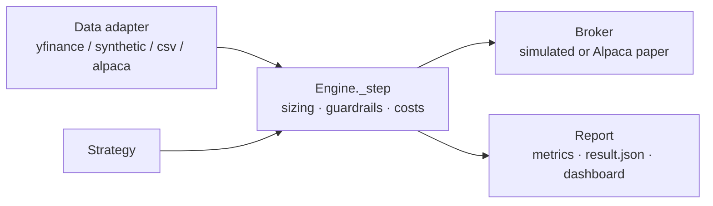

# algorithmic-trading

A test bench for **backtesting**, **paper trading**, and algorithmic trading
strategies on US equities. One event-driven engine runs a strategy over price
bars two ways — `backtest` over history and `paper` on recent data — with the
same execution, sizing, costs, and risk limits in both, so a backtest result is
one you can carry toward real capital.



> **Status:** built and green — backtest, paper (offline replay and live on
> Alpaca), seven strategies, enforced risk guardrails, parameter sweep and
> walk-forward validation, intraday bars, a 24/7 crypto market mode, and a web
> dashboard. The fast gate runs offline in seconds.
>
> **Not real-money.** The Alpaca path targets the paper endpoint. Known limits are
> written down, notably survivorship bias in curated universes
> ([ADR-0027](docs/adr/0027-survivorship-bias.md)). No candidate strategy has
> qualified to trade real capital yet. Detailed history:
> [`docs/build-history.md`](docs/build-history.md); when docs disagree with the
> code, the code wins.

## Quickstart

Requires [uv](https://docs.astral.sh/uv/) and Python 3.13+.

```bash
make setup   # install locked deps + the pre-push hook
make check   # lint + type-check + fast tests (no network)

# Backtest with no network at all, using the deterministic synthetic generator:
uv run trading backtest --strategy equal_weight --source synthetic \
  --symbols AAA,BBB,CCC --from 2021-01-01 --to 2022-12-31

# A cross-sectional strategy over a curated 20-name basket, with a sector cap:
uv run trading backtest --strategy cross_sectional --source synthetic \
  --symbols @blue20 --sector-map @blue20 --max-sector-exposure 0.30 \
  --from 2018-01-01 --to 2024-12-31
```

Drop `--source synthetic` (the default is `yfinance`) to backtest real
split/dividend-adjusted data once you have network access.

## What you can run

| Command | What it does |
|---------|--------------|
| `trading backtest` | Run a strategy over a historical range; prints metrics, writes `equity_curve.csv` and `result.json` |
| `trading paper` | Same engine on recent bars — `--once` replays offline, `--live` follows the wall clock |
| `trading sweep` | Parameter grid and walk-forward validation as an outer loop over backtests |
| `trading dashboard` | Render a run's `result.json` — `--static` (self-contained HTML, stdlib only) or `--serve` |
| `trading gen-data` | Write deterministic synthetic OHLCV bars to CSV |

**Strategies:** `buy_and_hold` (correctness baseline), `sma_crossover`,
`equal_weight`, `momentum`, `mean_reversion`, `cross_sectional`,
`trend_following`.

**Data sources:** `yfinance` (cached, adjusted), `synthetic` (offline,
deterministic), `csv` (bring your own), `alpaca` (real bars, daily or intraday; crypto with `--market crypto`).

**Optional extras:** `plot` (matplotlib PNG), `dashboard` (FastAPI server),
`alpaca` (live paper trading) — e.g. `uv sync --extra dashboard`.

## What this bench refuses to do

It is built as a stepping stone toward real capital, so it favors honest numbers
over flattering ones:

- **No look-ahead.** An order submitted on bar *t* fills no earlier than *t+1*,
  structurally — the strategy context cannot see a future bar, and a cheat
  strategy proves it in the test suite (ADR-0001).
- **Pessimistic fills.** Next-open fills with configurable slippage and
  commission; an order that outruns cash is rejected (ADR-0004).
- **Total-return prices in backtests**, so a stock split is never misread as a
  50% crash (ADR-0008) — and **raw quotes in paper/live**, so a raw broker
  account is never marked on adjusted prices (ADR-0021).
- **Guardrails that veto, not warn.** Position, gross-exposure, and per-sector
  caps clamp orders, and a drawdown kill switch halts new entries while still
  allowing exits (ADR-0009, ADR-0013, ADR-0019).
- **Named biases.** Known limitations are written down rather than left implicit
  — survivorship bias (ADR-0027) and broker-verified tradability (ADR-0028).
- **No real-money orders.** The Alpaca path targets the paper endpoint.

## Docs

- [`docs/research-playbook.md`](docs/research-playbook.md) — the hypothesis-to-paper-trading loop.
- [`docs/adr/`](docs/adr/) — one architectural decision per file.
- [`docs/build-history.md`](docs/build-history.md) — dated log of what was built and measured.
- [`PLAN.md`](PLAN.md), [`SLICES.md`](SLICES.md), [`QUESTIONS.md`](QUESTIONS.md) — scope, slices, decision register.
- [`CLAUDE.md`](CLAUDE.md) — the brief for coding agents.

## Contributing

See [`CONTRIBUTING.md`](CONTRIBUTING.md) for setup, the quality gates and workflow.

## License

See [`LICENSE`](LICENSE) (Apache License 2.0).
